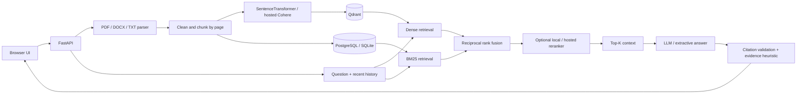

  # GroundedDocs

Upload a document. Ask a question. Follow the evidence.

A working RAG application with a Streamlit web app, an alternative FastAPI backend and browser UI, Qdrant retrieval, BM25 fusion, optional semantic embeddings and CrossEncoder reranking, and source-linked answers. No visitor registration is required.

## Live Demo

**Not deployed yet.** Run Streamlit locally at **http://localhost:8501**, or follow [the public deployment guide](docs/DEPLOYMENT.md) to create your own clickable HTTPS URL. No cloud account or paid LLM credentials are bundled with this repository.

**Streamlit Community Cloud is the recommended demo host.** Deploy `streamlit_app/app.py` from GitHub and paste your Gemini and Qdrant keys in **Advanced settings → Secrets**. See [deployment instructions](docs/DEPLOYMENT.md#streamlit-community-cloud-recommended-deployment) and the [placeholder Secrets template](.streamlit/secrets.toml.example). Do not upload the `data/` folder or real keys. The host downloads a cached CPU MiniLM model automatically.

Without a Gemini key the Streamlit app returns exact cited excerpts; without Qdrant credentials it uses a temporary in-memory vector store. Gemini failures also fall back to excerpts. Streamlit stores document text and conversation history for the browser session, with three sample documents and no visitor registration. Its confidence label is an experimental evidence heuristic, not an implementation of CAWC.

```powershell
python -m venv .venv
.venv/Scripts/python.exe -m pip install -r streamlit_app/requirements.txt
.venv/Scripts/python.exe -m streamlit run streamlit_app/app.py
```

For local keys, copy `.streamlit/secrets.toml.example` to `.streamlit/secrets.toml` and replace placeholders. The real file is excluded from Git and `github-upload/`. Keep CrossEncoder reranking off initially to reduce hosting memory use.

The existing FastAPI/Docker/Vercel versions remain available. Their root installation defaults to hash embeddings and excerpt answers. [Vercel alternative setup](docs/DEPLOYMENT.md#vercel-alternative-deployment) uses hosted PostgreSQL, Qdrant, and optionally Cohere; its serverless function excludes Streamlit and PyTorch.

## Features

- PDF, DOCX, and UTF-8 TXT uploads; whitespace cleanup; overlapping, page-preserving chunks.
- Dense Qdrant retrieval, BM25 keyword retrieval, reciprocal rank fusion, optional CrossEncoder reranking.
- Clickable numbered citations, PDF page numbers, chunk numbers, retrieved passages, and an extracted-source viewer.
- Session document library and conversation history in Streamlit; persistent SQL library and last 50 turns in the FastAPI version. Simple follow-up query expansion.
- Three fictional sample documents in each new browser workspace.
- No registration: Streamlit sessions separate workspaces; FastAPI uses an HttpOnly, SameSite browser cookie.
- Low-evidence refusal and invalid-citation rejection; an experimental grounding hook.
- Configurable chunk sizes (256/512/1024 **words**), top-K (3/5/10), search method, and reranking.
- Request, file, document, chunk, and workspace limits; source content is rendered as text, not HTML.

## Architecture

The Streamlit deployment calls the parser and retrieval pipeline directly, caches the local embedding model, stores vectors in Qdrant Cloud (or memory), and calls Gemini on the server. Source text and history are held in session state. The diagram below describes the retained FastAPI deployment.



The UI and API share one origin, simplifying deployment and keeping provider secrets on the backend. SQL stores document metadata, extracted passages, and conversations. Qdrant stores vectors and workspace/document identifiers. Local startup rebuilds the selected vector collection. Vercel cold starts avoid corpus-wide reindexing; a workspace's documents are reindexed when their embedding configuration changes. Original binary uploads are not retained.

## Tech Stack

| Layer | Technology |
| --- | --- |
| API | Python 3.11+, FastAPI, Pydantic |
| UI | Responsive HTML/CSS/JavaScript, served by FastAPI |
| Parsing | pypdf, python-docx |
| Embeddings | Local MiniLM; hosted Cohere `embed-v4.0` on Vercel |
| Vectors | Qdrant server or embedded local Qdrant |
| Keyword retrieval | rank-bm25 |
| Reranking | Local MiniLM CrossEncoder; hosted Cohere `rerank-v3.5` on Vercel |
| Generation | Qwen or another chat-completions-compatible endpoint; API-key-free extractive fallback |
| Persistence | SQLAlchemy, PostgreSQL or SQLite |
| Deployment | Streamlit Community Cloud; Vercel FastAPI; Docker Compose; Render Blueprint |

## How RAG works

1. Parse the upload, preserving physical PDF page numbers. DOCX and TXT have chunk references instead of invented pages.
2. Normalize whitespace and split each page into overlapping word windows. Chunk settings apply to **new uploads**; re-upload to re-chunk an existing document.
3. Embed chunks and upsert Qdrant points under the browser's workspace. Persist full text and metadata in SQL.
4. Search the workspace using dense similarity and/or BM25. Hybrid retrieval sums `1 / (60 + rank)` across the two rankings.
5. Optionally score candidate question/passage pairs with a CrossEncoder, then keep top-K.
6. Produce exact excerpts, or send the context and recent conversation to the configured LLM with document-grounding instructions.
7. Reject insufficient lexical evidence and invalid citation identifiers. Return the answer, citations, all retrieved passages, grounding metadata, and latency.

Implementation references: [Qdrant points](https://qdrant.tech/documentation/concepts/points/) and [Sentence Transformers CrossEncoders](https://sbert.net/examples/cross_encoder/applications/README.html).

## Grounding and the CAWC extension

No original CAWC implementation was supplied. `app/grounding.py` contains a deliberately labeled **experimental lexical-evidence heuristic**, not a reproduction of CAWC.

- Query coverage measures how many non-stopword question terms appear in the strongest passage.
- Coverage below 0.35 triggers abstention; otherwise the answer can proceed.
- The UI shows **Low** or **Moderate** evidence confidence, never a fabricated calibrated probability.
- Generated citation numbers must resolve to supplied context passages.
- These checks do **not** verify entailment, contradictions, every factual claim, or prompt-injection resistance.

Replace `evidence_check()` with a validated CAWC implementation or an entailment/claim-verification model when available, keeping the result schema. Calibrate thresholds on labeled supported and unsupported questions before making confidence claims.

## Local Setup

On this prepared Windows workspace, run `./start.ps1` to start the app. The local ignored `.env` enables the downloaded semantic embedding and reranking models. For a fresh checkout:

```powershell
python -m venv .venv
.\.venv\Scripts\Activate.ps1
pip install -r requirements.txt
Copy-Item .env.example .env
uvicorn app.main:app --host 127.0.0.1 --port 8000
```

On macOS/Linux, activate with `source .venv/bin/activate` and copy the configuration with `cp .env.example .env`. Open **http://localhost:8000**. The default offline mode needs no model downloads or API keys after dependencies are installed.

For semantic retrieval:

```text
pip install -r requirements-models.txt
```

Set `EMBEDDING_BACKEND=sentence-transformers` and `ENABLE_RERANKER=true` in `.env`, then restart. First startup downloads both model weights and can take several minutes. Use a persistent model cache in deployed environments. CPU inference is supported.

For an LLM-written answer, set `LLM_BASE_URL` to a chat-completions-compatible API prefix (normally ending in `/v1`), `LLM_API_KEY`, and `LLM_MODEL`. The backend appends `/chat/completions`. Leaving the base URL empty selects extractive mode. Provider errors return a clear 502 response; they do not silently masquerade as successful generation.

## Docker Setup

```sh
docker compose up --build
```

Open **http://localhost:8000**. Compose starts the application, PostgreSQL, and Qdrant with persistent volumes. Models are enabled and cached under `/app/data/models`. The first startup requires access to the model registry. Set `POSTGRES_PASSWORD` before public deployment. Database and Qdrant ports are not exposed to the host.

For a smaller offline demo container:

```sh
docker build --build-arg INSTALL_MODELS=false -t groundeddocs .
docker run --rm -p 8000:8000 -v grounded-data:/app/data groundeddocs
```

The app runs as a non-root user and uses one worker. Bind-mount permissions must allow that user to write `/app/data`. Docker has not been executed in the development workspace because Docker is not installed there.

## API Documentation

Interactive API: **http://localhost:8000/docs**. OpenAPI schema: `/openapi.json`.

| Method | Endpoint | Purpose |
| --- | --- | --- |
| GET | `/api/health` | Service mode and readiness |
| POST | `/api/workspace` | Initialize cookie and seed samples |
| GET | `/api/documents` | List documents in this workspace |
| POST | `/api/documents` | Multipart `file`, optional `chunk_size` |
| GET | `/api/documents/{id}/source` | Extracted source passages |
| DELETE | `/api/documents/{id}` | Delete vectors, text, and conversation excerpts |
| POST | `/api/chat` | Answer a question with evidence |
| GET | `/api/history` | Read conversation history |
| DELETE | `/api/history` | Start a new conversation |

```sh
curl -c cookies.txt -X POST http://localhost:8000/api/workspace
curl -b cookies.txt -F "file=@samples/Remote-work-policy.txt" http://localhost:8000/api/documents
curl -b cookies.txt -H "Content-Type: application/json" \
  -d '{"question":"What is the home office allowance?","mode":"hybrid","top_k":5,"rerank":true}' \
  http://localhost:8000/api/chat
```

Use `curl.exe` in Windows PowerShell if `curl` is an alias. Browser cookies act as anonymous workspace access tokens; clearing a cookie loses access to that workspace.

## Evaluation

Install test dependencies with `pip install -r requirements-dev.txt` before running pytest.

```sh
python scripts/evaluate.py
python scripts/evaluate.py --models --output eval/results-models.json
pytest -q
```

The runner evaluates all combinations of chunk size 256/512/1024, dense/hybrid retrieval, reranking on/off, and top-3/5/10: **36 configurations**. Offline mode measures 18 and explicitly marks the reranking configurations as skipped. Evaluation uses a temporary Qdrant directory and never changes the running app's data.

Metrics:

- **Recall@K:** fraction of labeled relevant chunks recovered. Relevance requires the expected source document and evidence phrase.
- **MRR:** reciprocal rank of the first relevant chunk, averaged across questions.
- **Faithfulness token-overlap proxy:** answer vocabulary found in cited passages. This is not semantic factuality evaluation.
- **Answer expected-phrase proxy:** whether the expected answer phrase appears in the response. This is not an LLM relevance judge.
- **Mean and p95 latency:** retrieval plus extractive generation; excludes model loading, ingestion, and external LLM latency.

The included ten-question set is a reproducibility fixture, **not a representative benchmark**. Its three short source documents often fit in one chunk, so Recall@3 can be trivially perfect and chunk-size comparisons cannot establish superiority. Use a larger held-out corpus, multi-page sources, hard negatives, paraphrases, unsupported questions, and independently labeled claims for defensible results.

## Results

Recorded offline results are in [`eval/results-offline.json`](eval/results-offline.json). At 512 words / top-5 / no reranking:

| Retrieval | Recall@5 | MRR | Expected phrase proxy |
| --- | --- | --- | --- |
| Hash dense | 1.00 | 0.95 | 1.00 |
| Hash + BM25 | 1.00 | 0.95 | 1.00 |

These are measured smoke-test results, not evidence that hashing is equivalent to semantic retrieval. Consult the JSON for timing and all configurations.

The model-backed run also completed **all 36 configurations**, recorded in [`eval/results-models.json`](eval/results-models.json). At 512 words / top-5, dense retrieval reached MRR 0.95; hybrid retrieval and dense retrieval with reranking reached MRR 1.00 on this small fixture. Recall@5 was 1.00 in each case. These results do not establish general retrieval quality because the test corpus is tiny.

Validation completed in the development workspace: **33 automated tests passed**, including hosted-provider HTTP contracts, Qdrant authentication/index configuration, imports without local disk writes, serverless cold starts, and bounded history responses. Streamlit UI sample chat, upload limits, session isolation, expiry cleanup, and Gemini success/quota/error contracts are included. JavaScript syntax checking and the original browser upload/answer/citation flow also passed. Browser checks reported no JavaScript errors and no mobile horizontal overflow. The original local semantic-model evaluation remains recorded separately. Docker, live hosted-service connections, public Streamlit/Vercel deployment, and live Gemini/paid LLM generation remain unverified.

## Screenshots


The Streamlit browser check passed with cached MiniLM semantic embeddings: sample answer, source display, DOCX upload and cited answer, and mobile layout, with no JavaScript page errors. Run `python scripts/browser_check_streamlit.py` against a local Streamlit server to repeat it.


Screenshots are captured from the running application. To regenerate after starting the API:

```sh
pip install -r requirements-dev.txt
python -m playwright install chromium
python scripts/browser_check.py
```

On Windows the script uses installed Microsoft Edge when available. It checks sample questions, citation navigation, source viewing, upload and answer flow, history reload, mobile overflow, and deletion.

## Limitations

- This is a deployable portfolio implementation, not a claim of audited production readiness.
- Anonymous cookie isolation is not an account/organization authorization system. Add authentication and tenancy controls for private organizational use.
- Embedded SQLite/Qdrant local deployments use one process. Vercel uses hosted PostgreSQL/Qdrant and PostgreSQL advisory locks for writes across instances. Background ingestion, schema migrations, and broader capacity testing are still needed for larger workloads.
- Sample seeding and indexing run synchronously. Local startup reindexes stored documents; Vercel avoids global reindexing on cold starts.
- BM25 is rebuilt from workspace text for each query. Local limits are 20 documents and 2,000 chunks per workspace, and 200 workspaces per deployment. Vercel caps uploads at 4 MiB, extracted text at 200 KB per document, and chunks at 200 per workspace; history responses are bounded to 3 MB.
- Streamlit text/history are temporary session state, with 24-hour best-effort vector cleanup; reconnecting may reset access. FastAPI text persists until deletion. Add durable accounts and retention controls for ongoing use. Streamlit demo limits are session/process scoped, not account-level abuse protection.
- No OCR. Scanned, password-protected, malformed, oversized, and textless documents are rejected. Complex PDF layouts and DOCX reading order can be imperfect.
- The chunk size is measured in words. Embedding and reranking models have token limits and may truncate long chunks; large-chunk results need careful interpretation.
- Original files and visual page layouts are not retained. Source inspection displays extracted text.
- Grounding is heuristic and English-oriented; valid citations do not prove factual support. Review evidence before relying on an answer.
- Streamlit uses the native Gemini REST API; FastAPI also supports a compatible chat-completions API. Live generation has not been verified without credentials.
- Docker, live hosted PostgreSQL/Qdrant/Cohere, and public hosting need deployment-environment validation. Local tests use SQLite/embedded Qdrant and controlled provider responses; credentials are not bundled.

## Repository map

```text
streamlit_app/ Streamlit Community Cloud entrypoint, engine and CPU dependencies
.streamlit/   Theme configuration and placeholder Secrets template
app/          API, parsing, storage, retrieval, generation, grounding
web/          Browser UI
samples/      Fictional demo documents
tests/        Ingestion, retrieval, isolation, citation and failure-path tests
eval/         Labeled questions and measured results
scripts/      Evaluation and browser verification
docs/         Deployment instructions and screenshots
compose.yaml  PostgreSQL + Qdrant + API
render.yaml   Single-service public hosting blueprint
vercel.json   Vercel FastAPI function configuration
.env.vercel.example  Hosted-service environment-variable checklist
```
